<h1 align="center">记得闪卡 · jidecards</h1>

<p align="center"><strong>每天一点，把知识记牢。</strong><br>面向 HarmonyOS NEXT 的开源闪卡应用，兼容 Anki 牌组，支持鸿蒙手机、平板和电脑。</p>

<p align="center">

[](https://github.com/wuweiyouzuoju/jidecards-anki-harmonyos/actions/workflows/ci.yml)
[](AppScope/app.json5)
[](https://www.harmonyos.com/)
[](https://appgallery.huawei.com/app/detail?id=com.jide.kapian&channelId=SHARE&source=appshare)
[](LICENSE)

</p>

<p align="center">
  <a href="https://appgallery.huawei.com/app/detail?id=com.jide.kapian&channelId=SHARE&source=appshare">华为应用市场下载</a> ·
  <a href="https://jidecards.com/">官网</a> ·
  <a href="https://jidecards.com/guides/harmonyos-anki/">鸿蒙 Anki 使用指南</a> ·
  <a href="docs/README.md">开发文档</a> ·
  <a href="CHANGELOG.md">更新记录</a> ·
  <a href="https://github.com/wuweiyouzuoju/jidecards-anki-harmonyos/issues">问题反馈</a>
</p>

<p align="center">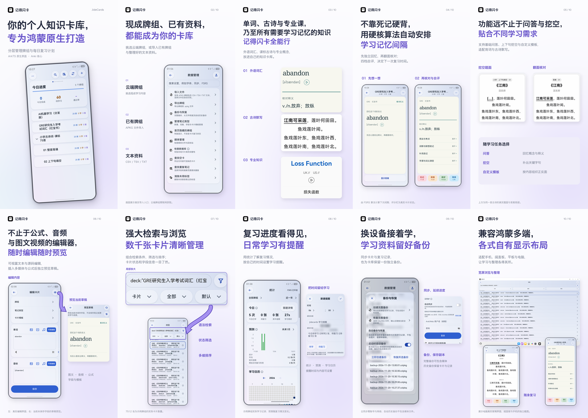</p>

记得闪卡用原生 ArkTS/ArkUI 构建界面，集合、模板渲染、调度和同步复用锁定版本的 Anki Rust Core。导入 `.apkg` 牌组后即可离线复习、编辑卡片和查看统计，并可通过 AnkiWeb、华为云空间或设备直连在多台设备之间保留学习进度。

**当前源码版本：26.11.22.19（versionCode 3159）** · [本次更新说明](docs/releases/26.11.22.19.md)

仓库版本号只以 [AppScope/app.json5](AppScope/app.json5) 为准；应用市场实际上架的版本以 AppGallery 页面为准，README 不另行维护商店版本号。

> 记得闪卡是独立开源项目，与 Ankitects、AnkiWeb 或 AnkiDroid 无关，也未获得其认可。

## 目录

- [应用截图](#应用截图)
- [功能一览](#功能一览)
- [安装](#安装)
- [数据与隐私](#数据与隐私)
- [从源码构建](#从源码构建)
- [架构与工程质量](#架构与工程质量)
- [项目结构与文档](#项目结构与文档)
- [参与贡献](#参与贡献)
- [版本与发布](#版本与发布)
- [许可证与第三方声明](#许可证与第三方声明)

## 应用截图

以下为手机端界面，画面来自实际运行截图，只做缩放和标注，不重绘界面。

<table>
  <tr>
    <td align="center" width="50%">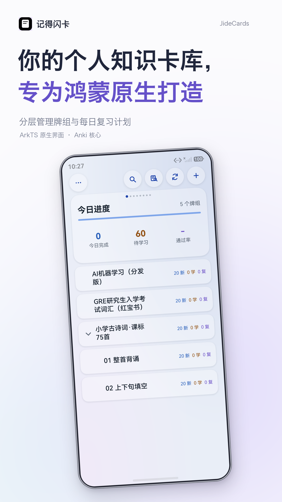<br><sub><b>01</b> 你的个人知识卡库</sub></td>
    <td align="center" width="50%">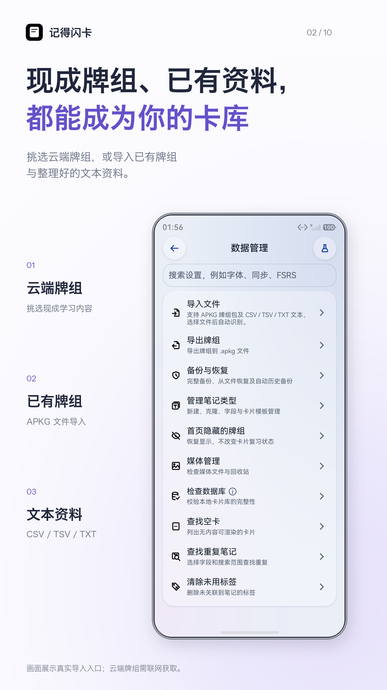<br><sub><b>02</b> 牌组与资料获取</sub></td>
  </tr>
  <tr>
    <td align="center">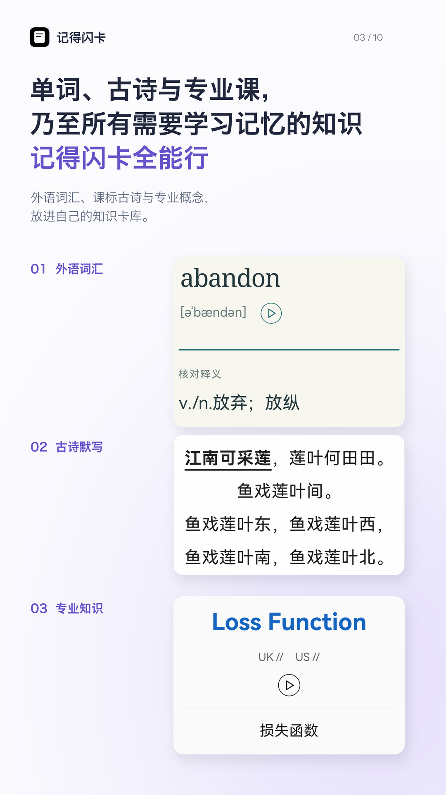<br><sub><b>03</b> 多学科学习</sub></td>
    <td align="center">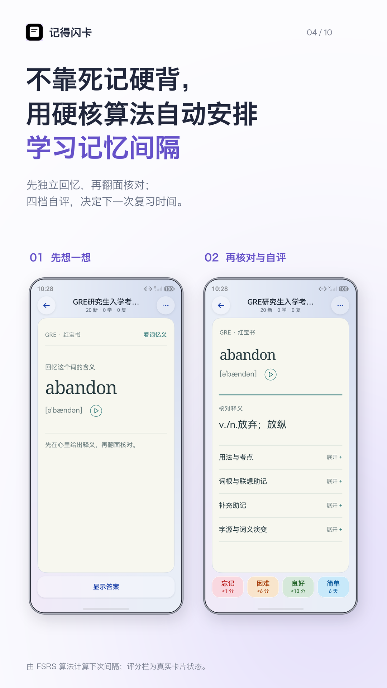<br><sub><b>04</b> 自动安排复习间隔</sub></td>
  </tr>
  <tr>
    <td align="center">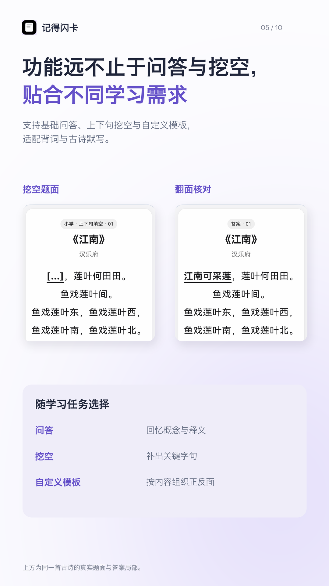<br><sub><b>05</b> 多种学习方式</sub></td>
    <td align="center">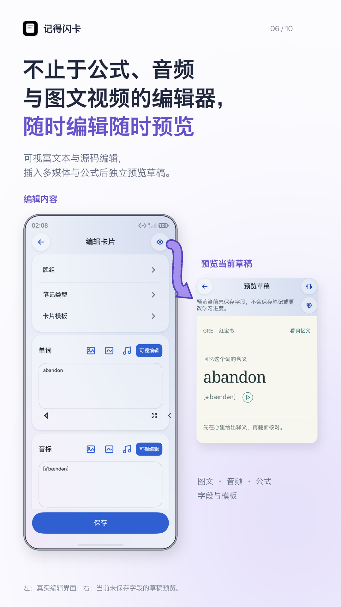<br><sub><b>06</b> 制卡编辑与预览</sub></td>
  </tr>
  <tr>
    <td align="center">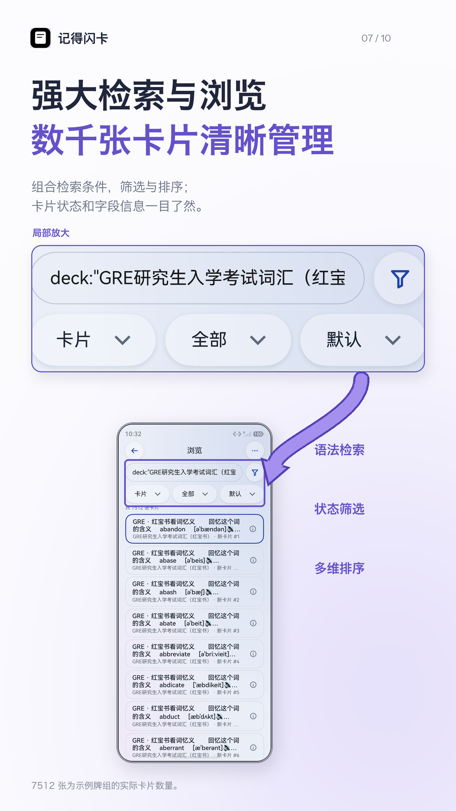<br><sub><b>07</b> 检索与卡库管理</sub></td>
    <td align="center">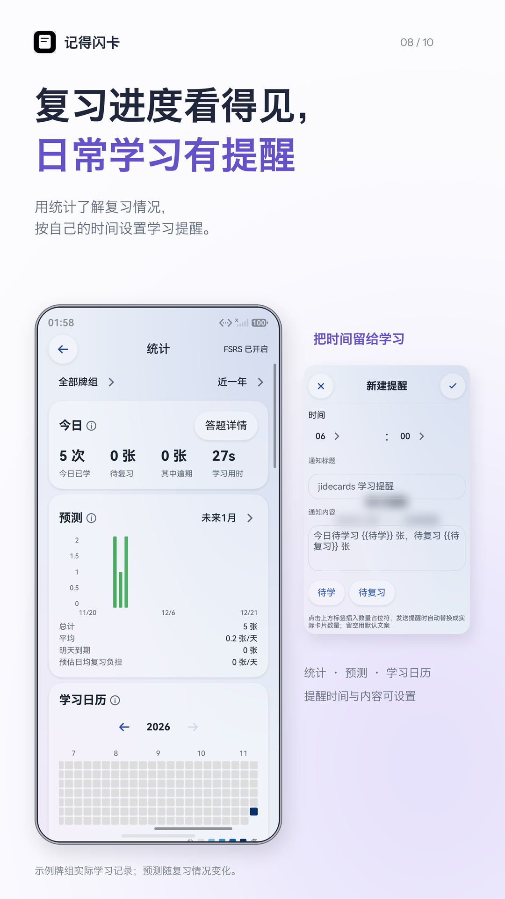<br><sub><b>08</b> 学习统计与提醒</sub></td>
  </tr>
  <tr>
    <td align="center">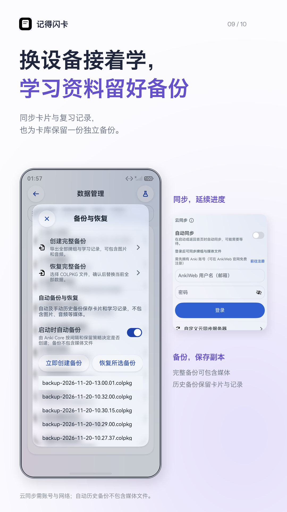<br><sub><b>09</b> 同步与独立备份</sub></td>
    <td align="center">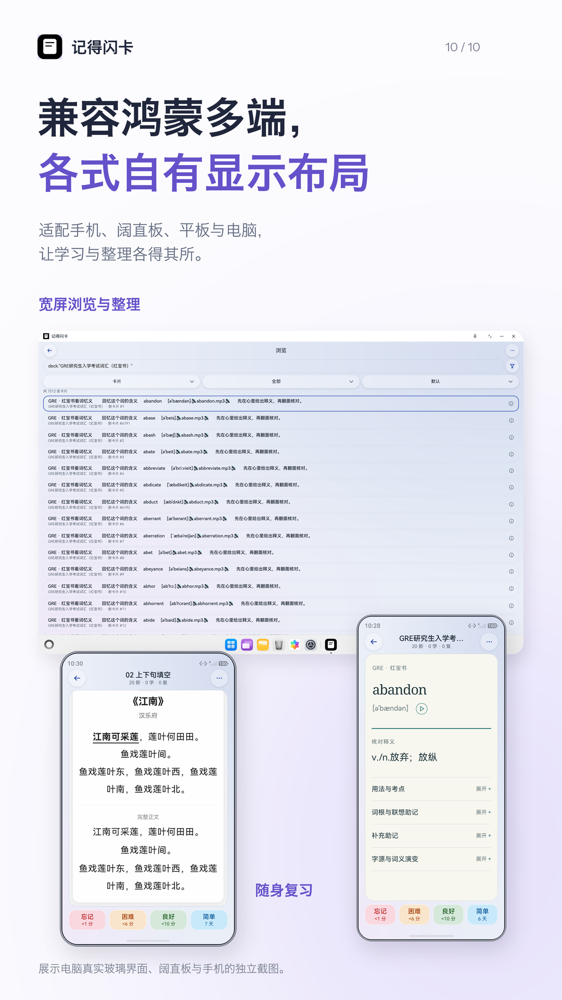<br><sub><b>10</b> 鸿蒙多端布局</sub></td>
  </tr>
</table>

平板端与电脑端同主题、同序号的宣传图分别位于 [docs/assets/promo/tablet/](docs/assets/promo/tablet/) 和 [docs/assets/promo/desktop/](docs/assets/promo/desktop/)，尺寸与制作约束见[宣传图说明](docs/assets/promo/README.md)。

## 功能一览

| 领域 | 主要能力 |
| --- | --- |
| 复习与调度 | Anki 26.05 Core 调度、FSRS 与参数优化、四档或双按钮评分、撤销重做、埋藏与暂停 |
| 卡片呈现 | 问答、完形填空、拼写输入、图片遮罩；图片、音频、MathJax、mhchem、MathML 与 TTS |
| 牌组与浏览 | 层级牌组、Cards/Notes 浏览、Anki 搜索语法、传统多列表格、批量编辑、查找替换 |
| 同步与备份 | AnkiWeb 与自定义服务器、华为云空间整库备份、设备直连（实验）、自动历史备份 |
| 导入导出 | `.apkg` / `.colpkg`、CSV / TSV / TXT、系统文件打开入口、文本导出 |
| 鸿蒙多端 | 手机、平板、鸿蒙电脑自适应布局，键盘鼠标操作，服务卡片，12 种语言与地区 |
| JIDE 助手 | 自然语言制卡改卡、资料阅读、联网检索，所有写入先出草稿再确认（默认隐藏） |

### 复习与调度

- 复用 Anki 26.05 Rust Core，集合格式、模板渲染与调度结果与 Anki 保持一致。
- 支持 FSRS、目标记忆保持率、FSRS 参数优化、复习负担模拟，以及日切时间、提前学习窗口、时间盒等全局偏好。
- 答案面可用四档评分，或只保留“忘记”和“良好”的双按钮评分；评分栏可停靠底部或悬浮。
- 支持撤销与重做、按卡片或整条笔记埋藏与暂停、学习完成页、卡片提示和上一张卡片信息。
- 学习页可录制和回放本次学习录音，白板可将当前卡面和笔迹保存为 PNG。详见[学习与媒体](docs/development/study-media.md)。
- 深色模式改善固定字色和脚本追加正文的对比度，切回浅色时恢复作者原有样式。

### 牌组、浏览与编辑

- 层级牌组支持新建、重命名、排序、拖动、别名、隐藏和背景图片；牌组选项使用独立页面，带草稿保护与预设管理。详见[首页与牌组选项](docs/development/home.md)。
- 浏览页提供卡片与笔记两种视图、牌组树和标签树、保存搜索和批量操作；传统表格模式下两种视图各自保存列配置。大屏下可分栏浏览与编辑。
- 新建和编辑笔记可预览未保存内容、多模板与填空编号；支持字段查重、富文本、绘图、录音与音频附件，以及笔记类型和模板管理。
- 正文可插入卡片引用，学习和预览时跳转到目标卡片；[Anki 电脑端配套插件](desktop/anki-note-links/README.md)需单独安装。
- 统计包含学习进度、预测、年历热力图、复习间隔、记忆稳定期、难度、可提取性和新增卡片，并提供 2×4 桌面服务卡片。
- 简洁版覆盖日常学习；实验版开放高级调度、自定义学习、过滤牌组等能力。

### 同步、导入与维护

- AnkiWeb 集合与媒体同步、自定义同步端点、自动同步及全量上传/下载；自定义 CA 证书暂无配置入口，见[同步边界](docs/development/sync-data.md#自定义同步端点与证书边界)。
- 华为云空间使用包含媒体的 Anki 整库备份包，恢复前自动创建本地备份，校验通过后才提示成功。
- 设备直连（实验）：同一 Wi-Fi 或热点下扫码配对，可分别授权学习记录同步或整库与媒体同步。真实双机与 AnkiWeb 账号组合尚未完成验收，范围见[同步与数据](docs/development/sync-data.md)。
- `.apkg` 导入可配置更新策略、查看进度和取消；整库替换提供空间预检和进程中断恢复。系统文件打开入口兼容 `application/vnd.anki`，见 [APKG 系统打开入口](docs/development/home.md#apkg-系统打开入口)。
- CSV / TSV / TXT 导入支持预览、字段映射和重复处理，详见[数据导入](docs/development/import-data.md)；笔记与卡片文本导出不含媒体和复习进度。
- 提供媒体引用与缺失检查、媒体回收站、数据库检查，以及标签和笔记维护工具。

### 鸿蒙多端体验

- 同一套代码适配手机、平板和鸿蒙电脑：宽屏首页记住上次选择的牌组，短横屏和小窗口单独优化工具栏与操作区。
- 鸿蒙电脑支持窗口置顶；鼠标右键打开牌组菜单或扩展多选，新增和编辑笔记支持 Ctrl+Enter 保存等快捷键。完整列表在“设置 → 学习帮助 → 键盘快捷键”，焦点规则见[浏览与编辑](docs/development/browser-stats.md)。
- 七套预设主题，以及 RGB／HEX 自定义主题色、自定义壁纸、玻璃和扁平两种材质；支持浅色、深色和跟随系统。
- 界面提供 12 种语言与地区：简体中文、香港与台湾繁体中文、英式与美式英语、意大利语、日语、越南语、韩语、俄语、德语和法语，日期和数字按地区格式显示。
- 导航、列表、设置和统计使用 ArkUI；Anki 卡片 HTML/CSS 由 HarmonyOS Web 组件渲染。

### JIDE 应用内助手

JIDE 是统一的自然语言对话入口，也可以从牌组、浏览或学习页带着当前上下文进入，通过受控工具协助学习和资料维护。

| 能力 | 范围 |
| --- | --- |
| 制卡与改卡 | 生成和编辑字段、标签，选择或新建牌组与笔记类型，预览后确认保存 |
| 资料阅读 | PDF、办公文档、电子书、文本、图片和视频；PDF 按需逐页读取，支持视觉理解、OCR 和视频按时间取帧 |
| 学习与设置 | 读取学习概览、卡片统计和牌组选项；经确认修改部分设置、共享模板和卡片外观 |
| 联网 | 独立开关下搜索并读取公开网页；Wikimedia 图片候选可随草稿确认导入 |
| 外部 Agent | 鸿蒙电脑实验版可开启本机 MCP 接入，供外部 Agent 调用；写入仍在应用内确认 |

卡库修改先生成可编辑草稿，列出字段、标签、目标和影响范围，确认后才写入；删除、类型迁移、共享模板等高风险操作需二次确认，执行前重新检查数据基线。

**AI 会话、制卡、改卡及设置入口默认隐藏。** 实验版设置中的开发者调试入口可在本机解锁，启动时读取已保存状态并统一发布 AppStorage 开关；联网工具默认关闭，部分能力还需配置对应模型服务。详见[应用内 Agent 说明](docs/development/agent.md)和[外部 Agent 本地 MCP](docs/development/external-agent.md)。

## 安装

### 普通用户

在[华为应用市场](https://appgallery.huawei.com/app/detail?id=com.jide.kapian&channelId=SHARE&source=appshare)搜索“记得闪卡”安装，导入已有 `.apkg` 牌组即可开始学习。建议先使用默认设置，熟悉评分和复习节奏后再调整 FSRS、提醒和外观。

鸿蒙电脑另有独立应用“记得闪卡 PC”（`com.jide.kapian.pc`），可与原版同时安装，两者数据和授权互不迁移，构建方式见 [PC 构建与发布](docs/development/pc-build.md)。

### 签名 HAP 开发包

[GitHub Release v26.11.09.9](https://github.com/wuweiyouzuoju/jidecards-anki-harmonyos/releases/tag/v26.11.09.9) 提供 [签名 HAP](https://github.com/wuweiyouzuoju/jidecards-anki-harmonyos/releases/download/v26.11.09.9/jidecards-v26.11.09.9-signed.hap) 与 [SHA-256 校验](https://github.com/wuweiyouzuoju/jidecards-anki-harmonyos/releases/download/v26.11.09.9/SHA256SUMS.txt)。该包为 debug 开发构建，含 arm64-v8a 与 x86_64 原生库，安装受包内签名和设备授权限制，不等同于应用市场安装包。开发设备只做覆盖安装：`hdc -t <connect-key> install -r <signed-hap>`。

### 兼容范围

- 搭载 HarmonyOS NEXT 的手机、平板和电脑（含 2-in-1 设备），最低兼容 API 21。
- 支持常用 Anki 牌组格式和自带媒体；自定义模板、插件字段和历史 schema 仍可能存在差异。作者 HTTP 脚本与授权表单的处理见[作者脚本与授权表单](docs/development/study-media.md#作者脚本授权表单与网络兼容2026-10-15)。
- AnkiWeb 同步需要用户自己的账号；自定义同步服务器需要可用的 HTTPS 端点。
- 不包含 Anki 桌面插件、Qt/Python 界面和桌面 LaTeX 运行时。锁定 Core 的往返回归不代表所有客户端与设备组合都已验收，证据见[核心互通说明](docs/development/core-interop.md)。

## 数据与隐私

卡库、媒体、备份和 JIDE 会话保存在本机。同步只按用户的配置连接 AnkiWeb、自定义服务器或华为云空间；设备直连的配对信息保存在本机，数据只在同一网络下已配对的个人设备之间传输。

使用 JIDE 时，消息及工具提供的卡片字段、资料片段或图片会发送给所选模型服务，联网检索的查询会发送给所选搜索服务。请按资料敏感程度选择服务；模型、搜索和同步凭证不应出现在问题报告或示例牌组中。

## 从源码构建

### 环境要求

| 工具 | 版本 |
| --- | --- |
| DevEco Studio | 26.0.0.851 |
| HarmonyOS SDK | 26.0.0.105，最低兼容 API 21，目标 SDK 26.0.0 |
| Node.js | 24.x（与 CI 一致） |
| Rust | 1.92.0，见 [rust-toolchain.toml](rust-toolchain.toml) |
| 其他 | `protoc`；主机测试需要 Visual Studio/MSVC，或 `cargo-zigbuild` 加 `zig` |

### 1. 获取源码与 Anki Core

```bash
git clone https://github.com/wuweiyouzuoju/jidecards-anki-harmonyos.git
cd jidecards-anki-harmonyos
```

Rust 后端锁定 Anki 26.05，提交 `e64c6b1`（见 [UPSTREAM.lock](UPSTREAM.lock)）。`third_party/` 不是 Git submodule，首次构建前在本地准备：

```bash
git clone https://github.com/ankitects/anki.git third_party/anki
git -C third_party/anki checkout --detach e64c6b1
git -C third_party/anki rev-parse --short=7 HEAD
git -C third_party/anki submodule update --init --depth 1 -- ftl/core-repo ftl/qt-repo
```

### 2. 准备公共 HAR 和签名

在闪卡仓库根目录运行以下命令，从公开源码构建所需的基础库 HAR。需要 Node.js 24+ 和 DevEco Studio。

```bash
git clone https://github.com/wuweiyouzuoju/jide-foundation.git "../记得系列基础"
git -C "../记得系列基础" checkout --detach a265b67bf0bbb86f824b2409e4b02053da48120b
(cd "../记得系列基础" && npm run build:harmony)
```

构建生成 `../记得系列基础/.local/packages/jide_foundation.har`。闪卡的[模块依赖配置](entry/oh-package.json5)从该位置读取 HAR，随后可继续执行下方的 `ohpm install`。

公共 [build-profile.json5](build-profile.json5) 不保存个人签名材料。复制 [config/signing.example.json](config/signing.example.json) 为 `.local/signing.json` 并填入本机签名，或用环境变量 `JIDECARDS_SIGNING_CONFIG` 指向外部 JSON。覆盖安装必须沿用原签名身份，详见[签名文档](docs/development/signing.md)。

### 3. 安装依赖、构建与测试

```bash
ohpm install
npm ci
npm run doctor      # 检查本机工具链
npm run build:app   # 构建 HAP
npm test            # Node 契约与单元测试
```

日常修改按[分级验证](docs/development/verification.md#按变更路径选择验证)只运行受影响的检查；完整验收入口：

```bash
npm run verify -- repo     # 可移植仓库与文档门禁
npm run verify -- native   # Rust 主机测试与原生门禁
npm run verify             # 完整测试、双架构构建与签名 HAP
```

设备验收只能用 `hdc -t <connect-key> install -r <signed-hap>` 覆盖安装，不要卸载应用或清除用户数据。Mac 环境与干净检出记录见 [Mac 构建](docs/development/mac-build.md)。

## 架构与工程质量

```text
ArkUI 页面 / 组件          entry/src/main/ets/pages、components
  -> 编排与纯模型          model/（*Session、*Controller，纯 TS，可在 Node 中直接测试）
  -> 领域 Service          backend/（protobuf 编解码与写入边界）
  -> Node-API 桥           native/（C++，只转发 3 个函数）
  -> Rust FFI + Anki Core  native/rsharmony，锁定 Anki 26.05
```

上层依赖下层，下层不反向依赖页面或组件，`model/` 中的纯模型不接触平台 Kit。这些规则由测试强制检查，不只靠约定。

| 方面 | 做法与证据 |
| --- | --- |
| 代码规范 | DevEco Code Linter（`@performance`、`@typescript-eslint` 推荐规则集），通过 `npm run lint:arkts` 复核，配置见 [code-linter.json5](code-linter.json5)，结果与规则调整依据见[代码检查记录](docs/quality/code-linter.md) |
| 编码约定 | [编码规范](docs/development/coding-standards.md)：分层、命名、ArkTS 约束、资源、统一日志、注释与测试 |
| 分层与依赖 | [architecture-boundaries 测试](tools/tests/architecture-boundaries.test.mjs)：导入可解析、无循环依赖、下层不依赖 UI、纯模型隔离平台能力 |
| 自动化测试 | `npm test` 约 4000 个用例，覆盖调度、同步、导入、浏览、学习和 JIDE；Rust 侧另有 FFI 单元测试和真实 Anki Core 集成测试 |
| 持续集成 | [CI](.github/workflows/ci.yml)：仓库测试、源码导出校验、浏览器卡片渲染、`cargo fmt` / `clippy -D warnings`、RPC 协议指纹 |
| 文档契约 | 文档中的版本、SDK、锁定提交和发布开关由测试与源码配置比对，相对链接和章节锚点自动校验 |

## 项目结构与文档

| 路径 | 内容 |
| --- | --- |
| [entry/src/main/ets/](entry/src/main/ets/) | ArkTS 页面、组件、模型和应用内 Agent |
| [native/](native/) | C++ Node-API 桥接与 Rust FFI |
| [native/agent-sandbox/](native/agent-sandbox/) | 独立的 QuickJS-NG / wasmi 纯计算沙箱 |
| [tools/](tools/) | 测试、诊断、构建和 APKG 工具 |
| [docs/](docs/) | 架构、开发约定、数据格式、验证与发布说明 |
| [docs/assets/promo/](docs/assets/promo/) | 手机、平板、电脑三端宣传图 |
| [PROJECT_CONTEXT.md](PROJECT_CONTEXT.md) | 编程 Agent 的任务入口与事实来源 |
| [AGENTS.md](AGENTS.md) | 仓库开发约定与不变量 |

推荐阅读顺序：[文档导航](docs/README.md) → [当前架构](docs/architecture.md) → [编码规范](docs/development/coding-standards.md) → [模块责任与边界](docs/development/ownership.md) → [开发任务契约](docs/development/task-contract.md)。发布门禁见[开发状态与发布门禁](docs/DEVELOPMENT_PLAN.md)。

## 参与贡献

欢迎通过 [Issues](https://github.com/wuweiyouzuoju/jidecards-anki-harmonyos/issues) 报告问题、提出建议，通过 [Pull Requests](https://github.com/wuweiyouzuoju/jidecards-anki-harmonyos/pulls) 提交修复、文档和翻译。问题报告请附应用版本、设备型号、系统版本、复现步骤及预期与实际结果；日志和示例牌组请先移除账号、密钥和个人学习内容。

修改代码前先读[贡献指南](CONTRIBUTING.md)，再按[项目任务入口](PROJECT_CONTEXT.md)定位领域文档和验证范围。每次提交保持一个明确目的，包含实现、回归测试和说明；PR 模板区分自动检查与实际设备验收。适合入手的方向：

- 在不同 HarmonyOS 版本和设备上做兼容性回归。
- 改进 Anki 牌组导入、公式、媒体、同步和统计的兼容性。
- 完善多语言界面、用户文档、测试和构建工具。
- 在实体设备上验证 JIDE 的联网、取消和写入确认边界。

## 版本与发布

源码版本由 [AppScope/app.json5](AppScope/app.json5) 中的 `versionName` 和 `versionCode` 定义。每次版本的变更见[更新记录](CHANGELOG.md)，逐版说明在 [docs/releases/](docs/releases/)。华为应用市场的上架版本以下载页面为准。

发布前的构建、测试和设备验收要求见[开发状态与发布门禁](docs/DEVELOPMENT_PLAN.md)和[应用市场发布](docs/development/appgallery-release.md)。CI 通过不代替实体设备验收；源码中的能力以当前发布开关为准。

## 许可证与第三方声明

本项目采用 [AGPL-3.0-or-later](LICENSE) 许可。Anki rslib 由 Ankitects Pty Ltd 及其贡献者提供，依据 AGPL-3.0-or-later 授权；MathJax、HarmonyOS 组件及其他依赖的版权与许可见 [NOTICE.md](NOTICE.md) 及各自源文件说明。

## 独立开发声明

截至目前，记得闪卡（jidecards）的开发与维护仍全程由可塑性天赋（wuweiyouzuoju）本人独立完成，不涉及团队协作或多人共同开发。任何声称“带领团队完成记得闪卡开发”，或将本项目归为团队开发成果的表述，均与事实不符。
