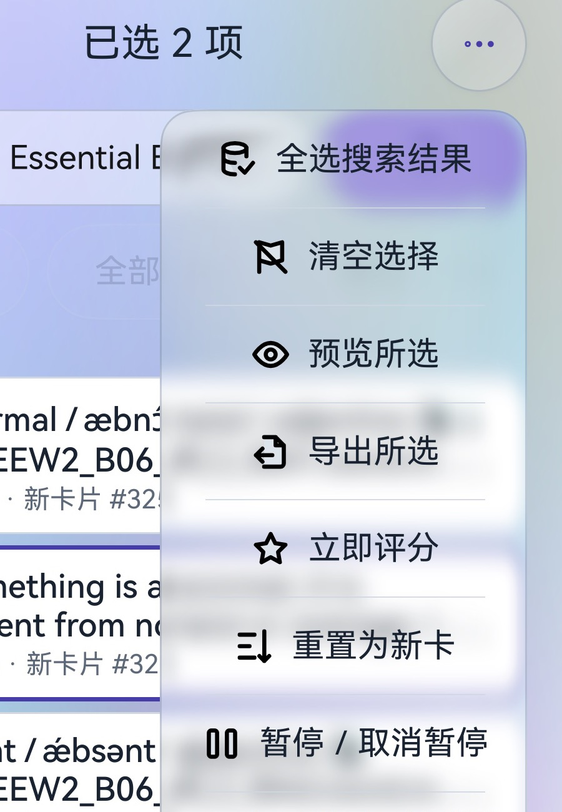

# 上架 3 个月好评榜首，接近第二名两倍：记得闪卡的“断崖式”体验与鸿蒙独占优势从哪来？

**3 个月** ｜ **鸿蒙端闪卡类好评第一** ｜ **接近第二名两倍**

先说结论：这篇文章不想只列功能，而是回答三个问题——为什么它能在 3 个月拿到这个成绩？为什么它的体验是**整个移动端**级别的“断崖”，而不只是“鸿蒙里还行”？为什么它能成为**目前鸿蒙端少数具备独占优势的软件之一**？

答案不在某一个功能点，而在六层能力同时成立：材质、交互、算法、调度、能力、生态。

> **阅读顺序：** 成绩 → 难题 → 体验层 → 地基层 → 上限层 → 生态层 → 定位 → 证据与边界 → 结语。

---

## 一、成绩：3 个月榜首，说明的不只是“有人喜欢”

据应用市场公开评价数据，记得闪卡上架 3 个月，在鸿蒙端闪卡类软件中好评数排名第一，接近第二名的两倍。

这个成绩至少说明三件事：

1. **它不是靠“新”赢的。** 3 个月足够让第一批用户度过新鲜期，进入“每天真的要用”的阶段；留存下来的好评，比下载量更难刷。
2. **它不是靠单一功能赢的。** 闪卡用户很挑剔：有人要 Anki 兼容，有人要好看，有人要 FSRS，有人要平板手写。只满足一类人，很难拿到接近第二名两倍的好评数。
3. **它踩中了鸿蒙端的空位。** 鸿蒙生态里，既有 Anki 级内核、又有原生体验的闪卡产品极少；多数产品要么是套壳 WebView，要么是自建轻量算法。

但成绩只是结果，不能当论证。真正要回答的是：**为什么是它？**

---

## 二、难题：闪卡为什么难做？

移动端闪卡应用长期被困在一个三角里：

- **好看的，往往算法浅。** 自建 SM-2 或简化间隔，短期能用，长期数据没有迁移价值。
- **算法强的，往往界面像十年前的桌面软件。** Anki 生态很强，但移动端体验长期是“能用”而不是“好用”。
- **两者都强的，往往只活在 iOS。** 鸿蒙端生态新，ArkUI 与 ArkWeb 的边界和 Android 完全不同，很多“移植”最后变成套一层 WebView。

所以，做一款“鸿蒙端闪卡”并不难；难的是同时做到：

1. **不重造调度器**，让用户已有的 Anki 牌组、复习记录、同步关系都能继续用；
2. **不牺牲原生体验**，让界面、动效、手势、键鼠都像鸿蒙原生应用；
3. **不放弃平台能力**，把鸿蒙独有的手写、图形、语音、卡片服务用起来；
4. **不闭门造车**，让 Agent、桌面插件、其他工具都能接进来。

记得闪卡的选择是：**核心不造轮子，体验重做一遍，平台能力用到极致，生态接口保持开放。**

这也是“断崖”的来源：不是某个功能比别人强十倍，而是六层同时成立，且每一层都能拿出源码和验收记录。

---

## 三、体验层（一）：液态玻璃不是滤镜，是实时光学

> **一句话：** 真玻璃 = 实时采样 + 位移折射 + 生命周期 + 性能预算。

社区习惯把这类效果叫“液态玻璃”。项目内部的名字更工程化：`GlassPanel`、`SharedGlassBackdrop`、`GlassOptics`。

叫法不重要，重要的是它**不是把背景调成半透明白**。

<p align="center">
  
  <br>
  <em>手机端批量操作菜单：背后的卡片标题、蓝色选中描边和渐变背景，会透过玻璃被模糊、染色。</em>
</p>

注意菜单背后的卡片标题、蓝色选中描边和渐变背景：它们没有被一块白色贴纸完全盖住，而是被玻璃轻微模糊、染色，并在边缘产生位移。这就是实时采样与折射，而不是半透明色块。

常见的“玻璃风”实现是：半透明白底 + 一点阴影 + 背景模糊。它看起来像玻璃，但缺两个关键行为：

- **背景是实时变化的**，不是一张静态模糊图；
- **边缘有折射**，越靠近圆角和轮廓，背景线条的位移越明显。

记得闪卡的做法是后者：

1. 用 `componentSnapshot` 抓取面板背后的真实正文；
2. 对抓取结果做 **5.5vp** 高斯模糊，得到磨砂纹理；
3. 用一张位移网格对纹理逐顶点采样，模拟玻璃边缘的折射；
4. 网格位移在 **36vp 过渡带**内按距离场衰减，最大约 **10vp**，圆角和异形轮廓都参与计算；
5. 用 `drawVertices` 把网格画到面板区域，而不是贴一张矩形图。

核心的网格生成在公共 HAR 的 `GlassOptics.ts` 里：

```ts
// 36vp 过渡带；位移在轮廓和带内缘归零，平直边缘保留折射强度
const band = Math.min(36 * density, Math.min(width, height) * 0.4);
const depth = Math.min(10 * density, band * 0.3);
const shift = Math.min(depth, band * 0.3) * 4 * frost * (1 - frost);
```

两个细节值得注意：

- **过渡带不是常数**：面板很小时会被压到短边的 40%，避免小面板整个都在“弯”；
- **位移在轮廓处归零**：玻璃边缘不会出现纹理撕裂，圆角也不会“翻折”。

仓库里还有一条专门的修复记录：早期版本在圆角中轴附近会出现纹理回折，修前 168×352vp、16vp 圆角的网格有 80 个反向三角形，修后为 0。这类问题不会在静态截图里暴露，只有连续转动、缩放、切换背景时才会看到。

### 一块玻璃的完整生命周期

“液态玻璃”最难的不是画出来，而是**什么时候画、画哪一帧、什么时候释放**。

记得闪卡把这件事拆成了一个有明确生命周期的会话：

- 每个 `UIContext` 一个采集会话，同一背景一帧只采一次；
- 面板打开时按 **50ms** 间隔采样，面板关闭且没有监听者时立即停止；
- 采样源是“正文”，玻璃面板本身是源外的兄弟节点，避免把自己采进去造成递归；
- 业务组件内嵌弹层时，传 `freezeDuringPanels=true`，首个弹层出现即冻结源，沿用打开前的帧，最后一个关闭才恢复；
- 旧纹理延迟一帧释放，避免绘制命令还在引用时被回收；
- 异步截图、模糊完成时再次检查许可，丢弃“迟到”的递归帧。

这套生命周期解决的是三个真实问题：**闪、脏、卡**。

- **闪**：面板打开时如果先显示半透明底、再换成玻璃，会明显跳一下。记得闪卡的做法是面板初始 `opacity=0.01`，等真实纹理 `onReady` 后，玻璃和文字在同一个容器里一起展开；不是“先给个假底色，250ms 后再说”。
- **脏**：弹层把自身采进背景，会越叠越白。源码用源引用计数和 `freezeDuringPanels` 把递归采样挡在门外。
- **卡**：每个面板都全屏截图会直接把 GPU 打满。后面会讲 512px 预算。

### 性能：把“像玻璃”压到 512px 预算

玻璃效果的成本主要在“抓图 + 模糊 + 逐顶点绘制”。记得闪卡没有用“降低模糊半径”这种牺牲观感的办法，而是承认一个事实：**模糊后的背景是低频信息，不需要全分辨率**。

```ts
// 最长边不超过 512 像素，且不超过原尺寸一半
export function glassCaptureScale(width: number, height: number): number {
  const longest = Math.max(width, height);
  return longest > 0 ? Math.min(0.5, 512 / longest) : 0.5;
}
```

在 HUAWEI MatePad 11.5 S 的两次 hitrace 中：

| 指标 | 优化前 | 优化后 |
| --- | ---: | ---: |
| `EffectImageRender::Render` 中位 | 40.48ms | **16.88ms** |
| 最大 | 50.84ms | **20.48ms** |
| hitrace 样本 | 10 次 | 18 次 |

同一轮 `UIVsyncTask` 最大 14.89→16.76ms，所以项目文档明确写了：**不能把后台处理下降报告成“已消除视觉闪动或掉帧”**。

给数字，也给数字的边界。这不是“跑分式”宣传，而是可复现的工程证据。

### 玻璃不是全局滤镜，而是一套有纪律的材质

如果整个 App 都糊一层玻璃，那不是高级，是灾难。记得闪卡的材质系统有几条硬规则：

- **默认扁平，玻璃可选**。首次启动不会强行上高成本材质；旧 API 或采样失败时保留扁平。
- **玻璃只用于“浮层”**：菜单、弹窗、选择器、浮动工具栏、评分面板；卡片正文、代码编辑区、白板画布保持实底。
- **同一语义必须复用同一入口**：普通弹窗走 `DialogFrame`，锚点菜单走 `AnchoredMenu`，卡片动作走 `CardActionMenu`，枚举选择走 `SurfaceSelect`。
- **主题只“轻染”玻璃**：浅色混入主题主色 10%、深色 12%，透明度不变；幻彩纹理由背景层拥有。
- **边框先设置，再恢复圆角**。ArkUI 的 `border` 默认值会覆盖 `borderRadius`，项目用静态扫描 `tools/arkui-border-order.mjs` 防止这类问题。

除了玻璃，界面本身也做了大量“看不见的功夫”：七套基础配色 + 一套幻彩主题；首页四段间距强制 `a=b=c=d`；顶栏按钮 44vp 点击区、18vp 图标；卡片 16vp 内边距；12 种语言与地区，日期/数字按地区格式化。

**所以，颜值不是换皮肤，是材质系统、生命周期、性能预算和组件纪律的总和。**

---

## 四、体验层（二）：把三步操作压成一步

> **一句话：** 直觉不是手势多，是完成一件事的步骤少。

“直觉化”经常被误解成“多放几个手势”。真正好的交互是：**用户不用学，手指自己会走**。

普通菜单是“点击 → 弹出 → 找到目标 → 再点”；记得闪卡的很多菜单是“**按住 → 滑到目标 → 松手执行**”。仅这一条，就把高频操作的步骤压掉了一半。

### 按住滑动菜单

- 按住 **200ms** 展开；
- 手指滑过时实时高亮当前可用项；
- 松手执行，移出/取消/第二指按下都不执行；
- 子菜单停留 **220ms** 只展开，松手落在叶项才执行；
- 菜单滚动边缘只滚动，不误触。

这套机制来自对 Telegram `ActionBarMenuItem` / `BottomSheet` 等源码的阅读，然后用 ArkUI 重新实现，不是搬 Android 代码。它覆盖首页更多/新建、牌组预览、学习/浏览/预览更多、浏览模式/筛选/排序、设置模式等入口。

它带来的体验差异很直接：**高频操作少一次点击，而且手指不需要离开屏幕**。在手机上，这比多一个“快捷方式”有用得多。

### 编辑轮盘：把格式工具放到拇指边

新增/编辑笔记时，格式工具不是塞在字段上方的一排按钮，而是屏幕侧边的**浮动轮盘**：

- 旋转或纵向移动选择工具，松手定位；
- 粗体/斜体/下划线/荧光保持多选；
- 字号、标题沿外弧展开；
- 键盘弹出、隐藏、旋转、多指、后台切换都会取消并复位，不会留下“半开”状态；
- 轮盘可以设置为“进入编辑时自动展开”或“键盘弹出时自动展开”，偏好持久化。

这让“选中文字 → 加粗 → 继续输入”变成一只手就能完成的动作，而不是在键盘和工具栏之间来回跳。

### 学习手势：4 宫格/9 宫格、滑动、多指、摇一摇

学习页的手势不是固定写死的，而是一套可配置的输入映射：

- 上/下/左/右滑、双击、两指/三指/四指、摇一摇；
- 4 宫格/9 宫格 Tap Zone；
- 每个输入可以分别绑定“题面/答案面”的动作；
- 默认只保留最常用的“左滑良好、右滑困难、双击翻面”，完整配置在实验模式开启；
- 评分不能绕过答案面，翻面也不能在答案面重复触发。

这套配置的校验很严格：输入 ID、动作 ID、面别、重复绑定、版本号都检查，非法配置直接拒绝，不会“部分生效”。

### 动效：该快的地方快，该没有的地方没有

记得闪卡有两套动效档位（克制/灵动），但不是所有地方都加动画：

- 菜单：克制 150ms，灵动 220ms 弹簧展开，关闭 140ms 只淡出；
- 弹窗：92%→100% 缩放 + 淡入；
- 页面：前进/返回方向 16vp 平移到 0；
- 按钮按下：即时缩到 97.5%，松手恢复，不延迟操作；
- 数字/文字变化：120/180ms 局部淡入淡出，快速更新会合并到最新值；
- 列表：稳定 key + `maintainVisibleContentPosition(true)`，可见区外增删不跳位；
- 结果提示：6 秒自动关闭，只有真正产生新历史记录时才显示“撤销”。

有一个反常识的选择：**学习页显示答案、切换卡片没有额外翻卡动画**，因为闪卡的核心是“快速判断”，翻卡动画再漂亮，也是在用户和知识之间加延迟。

### 平板、PC、键鼠：不是把手机界面拉宽

- 手机、平板、2-in-1 三种设备形态；
- 宽屏是主从布局：左侧牌组列表，右侧常驻详情，不是简单放大；
- 键盘快捷键覆盖首页、浏览、学习、编辑、模板，学习页显示当前自定义绑定；
- 鼠标右键在指针位置打开牌组菜单、进入/扩展多选、调用目录树的长按操作；
- 浏览页支持传统多列表格模式，Cards/Notes 各自保存列配置，可替换、增减、重排；
- 文本输入保留原生按键和右键菜单，不抢输入法的活。

**直觉不是手势数量，是完成一件事的操作成本。** 这一层，记得闪卡把很多“三步”压成了“一步”。

---

## 五、地基层（一）：记忆算法，不造轮子但把轮子用到底

> **一句话：** 算法不重写，但每个参数都要能落地。

闪卡应用最容易被低估的是算法。界面可以一个月做出来，调度错了，用户三个月的复习数据就废了。

记得闪卡的选择很明确：**调度、FSRS、队列、埋藏/暂停、完成判定全部来自 Anki Core，前端不另写算法。**

项目锁定 Anki 26.05，提交 `e64c6b1`，通过 Rust FFI 接入。调用链是：

```text
ArkUI 页面/组件
  → ArkTS 领域 Service（protobuf 编解码）
  → 后端会话/客户端
  → libjidecards.so（Node-API C++ 纯转发）
  → rsharmony（Rust C ABI、句柄、缓冲区所有权）
  → Anki 26.05 Rust Core
```

有两个不变量非常关键：

- **ArkTS 不直接读写 `collection.anki2`**，也不实现 SM-2、FSRS 或队列选择；
- **`SchedulingStates` 在 ArkTS 侧保持原始 protobuf 字节并原样回写**。前端不重新编码状态树，避免“看起来一样、字段已经丢了”的隐性数据损坏。

这两条决定了它不是“参考 Anki 做的另一个 App”，而是**能和 Anki 生态对得上账的客户端**。

### FSRS 不是开关，是一整套参数

很多产品把 FSRS 做成一个“开/关”。记得闪卡把 Core 暴露的参数基本接全了：

- 目标记忆保持率（desired retention）；
- 最大复习间隔；
- 简单日/轻松日权重（easy days）；
- 复习顺序；
- 学习/重学步骤数；
- 历史保持率；
- 暂停/埋藏/ Leeches 策略；
- FSRS 参数 17/19/21 个的三代格式（`fsrsParams4/5/6`）。

参数优化也不是“点一下算个分”，而是走 Core 的真实拟合：

```ts
// 以预设为范围，读取真实 revlog，忽略指定日期之前的历史
export function fsrsOptimizeInput(config, healthCheck, presetSearch) {
  return {
    search: config.config.paramSearch.trim() || presetSearch,
    currentParams: fsrsParams(config.config),
    ignoreRevlogsBeforeMs: timestamp,
    numOfRelearningSteps: config.config.relearnSteps.length,
    healthCheck,
  };
}
```

它还支持**复习负担模拟**：给定参数、目标保持率、每日新卡/复习上限、最大间隔、简单日权重，模拟未来最多 **3650 天**的到期量。

对长期使用者来说，这比“今天有多少张卡”重要得多——它回答的是“我按这个设置学一年，会不会被压垮”。

### 自定义调度：把“高级玩家”的需求关进沙箱

Anki 的 collection 级自定义调度脚本，是很多重度用户的命根子。记得闪卡没有选择“不支持”，也没有选择“直接在卡片 WebView 里跑”，而是：

- 用 **QuickJS + Wasm** 沙箱执行；
- 限制 **3 秒**、燃料、内存、脚本最大 **60000 字节**；
- 不提供 DOM、网络、`await`、计时器；
- 输入 `states`、四档 `customData`、`ctx`，输出四档候选状态；
- 原生侧按字段打补丁：只替换脚本明确修改的已知字段，`current` 和未修改字段保持原始字节；
- 非法 JSON、未知字段、越界数值、多个 oneof 分支、改 `current` 全部拒绝；
- 失败不静默回退，必须用户确认后才按标准调度继续。

这是一个“有明确边界的同步脚本子集”，不是完整的 AnkiDroid WebView 环境。但它把最危险的部分——**任意脚本访问集合、网络、页面桥接**——挡在了沙箱外。

### 统计：让调度结果可解释

统计页不是只有“今天学了 20 张”。它把 FSRS 的状态拆开：记忆稳定度、难度、可提取性、真实保持率、未来到期预测、年历热力图、复习间隔分布、小时分布、新增卡片、回答按钮分布。

这些指标的价值在于：当用户觉得“怎么老是被安排到明天”时，他能看到是稳定度低、难度高，还是目标保持率设得太高。

**算法不是黑箱，才有调整的依据。**

---

## 六、地基层（二）：内核调度，让 Rust Core 在鸿蒙上“像原生”

> **一句话：** 快不是“用了 Rust”，是每个等待都能被调度、取消、预取。

“内核调度”可以拆成三层：

- **记忆调度**：FSRS 决定“下一张卡什么时候出现”；
- **运行时调度**：原生桥决定“一次调用怎么排队、怎么取消、怎么预取”；
- **任务调度**：首页决定“启动时先做什么、什么可以等”。

### 原生桥：薄，但是稳

C++ 层只导出三个函数：

```text
openBackend(init): number
runMethodRaw(handle, service, method, input): Promise<Uint8Array>
closeBackend(handle): void
```

它不理解卡片、牌组、FSRS，也不拼业务错误文案。`runMethodRaw` 把 `Uint8Array` 复制到原生任务，放进 `napi_async_work`，完成后再解析 Promise。

Rust 侧用全局注册表给每个 Backend 分配非零句柄，`Arc<Mutex<...>>` 保证同一 Backend 的调用串行化，不同句柄彼此独立；每个跨边界调用都包在 `catch_unwind()` 里，panic 不会穿过 C ABI 把 ArkTS 进程带走；返回缓冲区由 Rust 分配、由对应释放函数回收。

这套设计的“笨”是优点：跨语言层越薄，上游协议变化时越容易定位问题。

### 取消：不能排在网络调用后面

同步是闪卡应用最容易“卡死”的地方。用户点了“取消”，如果取消信号还要排在正在进行的网络调用后面，按钮就会像坏了一样。

记得闪卡在 NAPI 层做了一个很关键的分流：

```cpp
// AbortSync 只发取消信号；不依赖可能被集合调用占满的工作线程池。
if (call->input.empty() &&
    ((call->service == RPC_SYNC_SERVICE && call->method == RPC_ABORT_SYNC) ||
     (call->service == RPC_COLLECTION_SERVICE &&
      (call->method == RPC_LATEST_PROGRESS || call->method == RPC_SET_WANTS_ABORT)))) {
    ExecuteCall(env, call.get());
    CompleteCall(env, napi_ok, call.release());
    return promise;
}
```

`AbortSync` 直接在当前线程执行，只发送 Core 的取消信号，不排队、不等锁。普通数据库调用仍然串行，集合占用要等真实调用结束后才释放。

这里有一个很重要的语义边界：**取消同步 ≠ 回滚完成**。取消只是让 Core 停下，已经发生的写入仍然按 Core 的事务语义处理；UI 不能假装“什么都没发生”。

### 预取：只预取一张，而且只预取“内容”

学习页切卡慢，通常不是 Core 慢，是 Web 渲染慢。`CardRenderPrefetch` 做了三件事：

- 只缓存**一张**候选卡的 Core 渲染结果，最长 30 秒；
- 当前卡面确认后才开始准备，不提前执行未来卡的模板 JavaScript、不提取/播放未来音频；
- 评分后仍然重新读取 Core 队首、原始调度字节、牌组设置、间隔和标记，只有实际 `cardId` 匹配才复用内容。

“只预取一张”的克制很重要：预取一整队会占内存，也会让模板脚本在用户没看到卡片时产生副作用；预取“内容”而不是“整个 Web 页面”，避免作者脚本、音频、计时器提前跑；评分引起同胞埋藏、重复学习、队首变化时，缓存自然失效，不会拿错卡。

### 双 Web 槽：不让用户看到“白屏闪一下”

普通 WebView 换卡是“清空 → 加载 → 白屏 → 新卡”。记得闪卡固定挂载两个 Web：

1. 新文档在**备用槽**完成脚本、公式、布局；
2. 等两次动画帧，确认真的画出来了；
3. 再切换到可见槽；
4. 当前槽保留完整旧帧，备用槽不参与输入；
5. 切换后冻结、静音旧视图，迟到完成不能在后台解除静音。

这比“加一个 loading 动画”难得多，因为它要处理：旧文档回调、脚本超时、渲染进程退出、前后台切换、同卡翻面保留 `sessionStorage`、跨卡新文档隔离。

对照 AnkiDroid 的单 WebView 生命周期，记得闪卡选择了更重的双槽方案。代价是内存和复杂度，收益是**连续切卡时没有整块白屏**。

### MathJax：2.3MB 的引擎，不该每张卡都解析

普通静态卡片原先每次新文档都要解析约 **2.3MB** 的 MathJax 引擎。记得闪卡做了一次很细的按需加载：

- 检查 Core 渲染的两面（优先已解析 HTML）及模板 CSS；
- 只有静态且不含公式线索时，才省去大引擎；
- 任一面含 TeX 分隔符、反斜线、MathML、可能编码公式的实体，或模板脚本/事件属性/JavaScript 链接/嵌入对象，就保守加载完整引擎；
- 背面才有公式也在题面准备，不能因为当前面没公式而让翻面失效；
- 只有实际启动引擎后才等待 Promise 和排版，成功确认仍等两次动画帧，不用固定延时替代绘制确认。

浏览器 4 倍 CPU 降速下，同一进程普通卡“完整引擎/省略引擎”每组 6 次、去掉首轮后的中位数是 **245ms / 106ms**。这个数字只测“网页导航到渲染确认”，不含 Core 查询、ArkUI 页面进入和设备合成，但足够说明按需加载的收益量级。

### 首页任务调度：先让用户学起来

首页启动时有很多事：读牌组树、读统计、检查公告、自动同步、展示引导、处理外部 APKG。记得闪卡没有把这些串成一条链，而是分层：

- `HomeDataRepository.load()` 只读牌组树、展示偏好和隐藏列表；完成选择校验后**立即放行学习**；
- 统计单独走 `statisticsQueue`，旧代次、离页、等待导航的任务直接跳过；
- `HomeWorkCoordinator` 定义优先级：外部文件 → 待执行导航 → 手动同步 → 公告 → 引导；
- 手动同步可以越过尚未展示的启动工作，但仍等待真实集合占用；
- 学习、编辑、弹层、同步期间，公告和自动同步让路。

这解释了一个体验差异：**为什么有的 App 启动后要转半天，记得闪卡能先让你点进牌组**。不是它读得快，是它知道什么可以等。

**快不是“用了 Rust”，是把每一个等待都拆开、排好序、能取消。**

---

## 七、上限层：移动端不是阉割版

> **一句话：** 移动端不是“功能少一点”，是把桌面主链路完整搬过来。

很多鸿蒙闪卡应用的功能上限是“能导入、能复习、能看统计”。记得闪卡把上限拉到了“可以替代桌面端日常使用”。

**数据进得来，也出得去。** `.apkg` 牌组导入/导出，`.colpkg` 集合备份/恢复，CSV/TSV/TXT 导入预览，系统文件打开入口，导入前空间预检与自动安全副本，笔记/卡片文本导出，媒体检查与回收站，自动历史备份。

**同步不是只连 AnkiWeb。** AnkiWeb 集合与媒体同步、自定义同步端点、自动同步、全量上传/下载、冲突确认，以及实验性的设备直连。同步的难点从来不是“发请求”，而是冲突、取消、占用、回滚；记得闪卡把这些都拆成了独立状态机，而不是一个 `isSyncing` 布尔值。

**浏览和编辑是“桌面级”的。** Cards/Notes 双模式、Anki 搜索语法、保存搜索、完整搜索结果全选、Shift 区间选择、批量改牌组/旗标/暂停/恢复/到期、传统多列表格、笔记类型与模板管理、富文本、绘图、图片遮罩、图片/视频附件、白板、未保存内容预览。

**平台能力：手机、平板、PC 都能用。** 鸿蒙手机/平板/2-in-1；12 种语言与地区；深浅色与七套配色 + 幻彩；学习提醒、2×4 桌面服务卡片、DeepLink；键盘快捷键、鼠标右键、传统浏览模式；原生音频播放器 + CoreSpeechKit TTS；Pen Kit 原生手写白板；作者 HTML/CSS/JS 模板、jQuery 3.7.1、MathJax、mhchem、MathML。

**移动端不是“功能少一点”，而是把桌面端的主链路完整搬过来，再用原生能力重做一遍。**

---

## 八、生态层：Agent 时代，客户端要做“落地端”

> **一句话：** Agent 负责生产，客户端负责落地。

如果说前五层解决的是“这个 App 好不好用”，这一层解决的是“这个 App 能不能接住下一波生产力”。

2026 年的制卡方式正在变。以前是自己敲字段；现在是让 Agent 读讲义、PDF、网页，先生成一版，再人工校对。问题也随之而来：**Agent 生成的卡片怎么进闪卡？进来后怎么改？改完怎么不丢复习记录？卡片之间怎么建立关系？**

记得闪卡的答案不是“做一个万能 Agent”，而是把自己变成 Agent 的**落地端**。

```text
讲义 / PDF / 网页
  → 外部 Agent（WorkBuddy / TRAE）
  → .apkg
  → 导入确认
  → Anki Core / FSRS
```

### 外部 Agent 制卡：APKG 就是通用接口

应用内的入门说明直接给出了可执行范式：

- **制卡**：把讲义、笔记或学习资料交给 WorkBuddy、TRAE 这类能处理文件、运行代码的 Agent，说清范围、数量和卡片形式，要求交付可导入的 `.apkg` 文件；
- **改卡**：从牌组详情“更多”导出 APKG，交给 Agent 补充解析、精简答案、纠正错误，要求**保留原笔记标识和媒体**，输出修改后的 APKG；
- **导入前**：保留原包备份，核对后再导入；改动标识或笔记类型可能产生重复卡。

这条链路的价值在于“不绑定”：不绑定模型、不绑定客户端、不把风险交给模型、可回退。任何能写 APKG 的 Agent、脚本、工具都能接入；APKG 是 Anki 生态的通用格式；Agent 只产出文件，导入、校验、调度、复习仍由本地 Core 和用户确认完成。

对 Agent 来说，这是一条零 SDK、零账号、零私有协议的接入路径；对用户来说，最终决定权仍在导入确认。

**它不跟 Agent 竞争，它做 Agent 的“落地端”。**

### 应用内 JIDE：从“生成一段文本”到“生成可确认的草稿”

内测版里，记得闪卡还有一个应用内助手 JIDE。它不是“聊天框里吐一段 Markdown”，而是接着真实卡库的工具链：

- **制卡/改卡**：读取当前牌组、笔记类型、字段、标签，生成结构化草稿；用户预览、修改、确认后才写入；
- **资料阅读**：PDF、办公文档、电子书、文本、图片、视频；支持视觉理解、系统 OCR、视频按时间取帧制卡，并标注来源；
- **学习与应用**：读取学习概览、卡片统计、牌组选项和界面状态；部分设置可以提案修改；
- **偏好与计算**：用户确认保存的长期偏好；本地 JavaScript 纯计算沙箱，不获得文件、网络或卡库权限；
- **联网**：独立开关下的搜索/网页读取，默认关闭。

边界非常硬：模型不能访问裸 RPC、数据库、文件系统或 shell；工具目录是模型可见契约的唯一来源，稳定 ID 的读权限不自动变成写权限；所有卡库修改先生成 `ChangeDraft`，展示字段、标签、目标和影响范围，用户确认后才执行；删除、类型迁移、共享模板等高风险操作二次确认，执行前重新检查数据基线；正式版按发布策略逐步开放 AI 制卡/改卡入口，内测与开发者调试可解锁。

这就是“Agent 软件可以直接制卡”的两种形态：**外部 Agent 通过 APKG 制卡，内部 JIDE 通过受控工具制卡**。前者开放，后者安全，二者不冲突。

### 双向引用：开源才做得了的“跨端知识网络”

闪卡的一个老问题是：卡片是孤岛。你在 A 卡里提到 B 卡，但 B 卡不知道 A 卡的存在；在桌面端做的引用，手机端打不开；换个客户端，引用就丢了。

记得闪卡做了一套**可跨端、可被其他工具实现**的笔记引用规范。它不是“数据库里加个外键”，而是把关系写进笔记正文和隐藏注释里，跟随 Anki 同步走。

正文引用用标准 HTML 锚点：

```html
<a href="#jide-note:<encodeURIComponent(目标GUID)>">本处显示文字</a>
```

完整关系保存在兼容 v1 的隐藏注释里：

```html
<!--jide-links:v1:<encodeURIComponent(JSON)>-->
```

JSON 结构是 `{ "v": 1, "guid": "当前笔记GUID", "targets": ["目标笔记GUID"], "alias": "旧版全局显示文本" }`。

这套规范有几个很“工程”的细节：不加字段、不改笔记类型、不改模板；正向关系存下来，反向关系本地推导；逐处文字，不是全局别名；ArkTS 与桌面 Python 插件使用同一套 UTF-8 转义、GUID 校验和 v1 JSON 规则；字段、媒体、标签、完整关系同一次 Core 落盘；只导入单个牌组时目标缺失就保留引用并提示，不按同名内容替代；学习/预览里点正文引用打开目标，预览循环最多 32 层。

桌面端通过已安装 Anki 的 `note_will_flush` 钩子，在 Core 提交前同步正文与元数据；鸿蒙端不需要电脑初始化，首次保存就能准备关系。

为什么说“开源才做得了”？因为一个闭源 App 当然可以定义私有链接格式，但只有它自己能读；而记得闪卡把规范、隐藏注释格式、桌面插件和回归都公开了，**其他工具（包括 Agent）可以按同一规范读写**。

这才叫“制定规范”，不是“做一个功能”。

### 鸿蒙独占：压感白板不是“画布 + 笔刷”

如果说核心算法是“和 AnkiDroid 同级”，那压感白板就是“鸿蒙独占”的典型。

记得闪卡的手写不是自己用 Canvas 画线，而是直接挂载 HarmonyOS Pen Kit 的官方 `HandwriteComponent`：

- 钢笔、圆珠笔、铅笔、马克笔、荧光笔、马赛克笔、橡皮擦、套索、激光笔；
- 笔刷、历史、一笔成形、报点预测由官方引擎管理；
- 压感等笔特性由系统手写引擎处理，应用不自己造笔刷；
- 学习页把白板覆盖在卡片上，卡片仍可读；手写期间暂停自动前进/时间盒；
- 手写笔和手指分流：检测到笔后，绘图区手指不落墨；工具控件和双指缩放仍可用；
- 掌托隔离、两指平移/缩放、笔 Up 丢失后的活动触点清理都有处理；
- SDK 不可用、初始化超时或布局无效时，自动回退到原版 Canvas 白板。

这不是“把 Android 的代码搬过来”能得到的：Pen Kit 是鸿蒙的系统能力，真机依赖 `SystemCapability.Stylus.Handwrite` 和系统套件完整性。

**同样的 Anki 数据，在鸿蒙上可以有一块接近系统级手写笔感的白板。**

类似的独占能力还有：实时光学玻璃、CoreSpeechKit 的 TTS、2×4 桌面服务卡片、2-in-1 键鼠、设备直连。它们不是“UI 皮肤”，而是系统能力的具体使用。

---

## 九、定位：与 AnkiDroid 同级，为什么成了鸿蒙端的独占优势？

把记得闪卡和 AnkiDroid 放在一张表里，会更清楚“同级”和“差异化”分别指什么。

| 维度 | AnkiDroid / 传统 Anki 移动端 | 记得闪卡 |
| --- | --- | --- |
| 核心与调度 | Anki Core、FSRS、四档评分 | 锁定 Anki 26.05，FSRS/自定义调度 |
| 数据与同步 | APKG/COLPKG、AnkiWeb | 同，并增加外部 Agent 的 APKG 制卡/改卡工作流 |
| 界面 | Android 原生 | ArkUI + 实时光学玻璃 + 扁平/玻璃双材质 |
| 手写 | 应用内画布/第三方笔刷 | HarmonyOS Pen Kit 官方手写引擎（压感/套索/激光笔） |
| 系统集成 | Android 能力 | 鸿蒙卡片、提醒、TTS、2-in-1、设备直连 |
| 跨端引用 | 通常没有内置的跨端引用规范 | `#jide-note:` + `jide-links:v1` + 桌面插件 |
| 开源 | 是 | 是，AGPL-3.0-or-later，规范可复用 |

在**核心协议、调度算法、数据兼容**这些硬指标上，它和 AnkiDroid 是同一量级；它没有在“Anki 语义”上偷工减料。

但在**平台能力**上，它不是“鸿蒙版 AnkiDroid”，而是把鸿蒙的图形、手写、语音、窗口、卡片服务用到了别人用不到的地方：液态玻璃依赖 ArkUI RenderNode / `effectKit` / `drawVertices`；压感白板依赖 Pen Kit；TTS 依赖 CoreSpeechKit；桌面卡片、提醒、2-in-1 键鼠依赖鸿蒙的应用模型；设备直连依赖鸿蒙的网络与扫码能力。

所以，“断崖”不是说核心算法比 AnkiDroid 强一个数量级，而是说：

> **在核心同级的前提下，体验层和平台层可以拉开一个数量级的差距。**

这就是为什么它的断崖式体验是**整个移动端**的，而不只是“鸿蒙里比一比”：

- 和轻量闪卡 App 比，它有 Anki 级内核、FSRS、APKG/COLPKG、AnkiWeb、自定义调度；
- 和 AnkiDroid 比，它有原生材质、双 Web 槽、Pen Kit 手写、系统 TTS、桌面卡片、2-in-1 键鼠、设备直连、双向引用；
- 和桌面 Anki 比，它是移动端，能把“随手打开就学”这件事做到桌面端做不到。

**同级是底线，差异化才是上限。**

也正因为这些差异化能力高度依赖鸿蒙的系统能力，记得闪卡已经不只是“鸿蒙端一个不错的闪卡 App”，而是**目前鸿蒙端少数具备独占优势的软件之一**。

---

## 十、证据与边界：为什么这些不是 PPT

一个开源项目最容易骗人的地方是“文档写了等于做了”。记得闪卡的做法是反过来：**先写清楚边界，再拿证据说话。**

仓库有 `AGENTS.md`、`PROJECT_CONTEXT.md`、`docs/development/` 领域文档，规定每个模块的唯一责任入口、不变量和验证方式；每个功能变更要求“同类变更闭环”；验证分级，设备验收必须记录系统/API、设备形态、安装方式和实际操作；文档会明确写“未验证范围”。

几个可查的数字：

- 当前工作树 `entry/src/main/ets` 约 **755 个 ArkTS/TS 文件、12.8 万行**；`native/` 约 **1.39 万行 Rust**；`tools/tests` 约 **366 个测试文件**；
- 3.8.0 发布说明记录：完整 Node 回归 **3595 项通过、35 项失败**，失败项逐条记录，没有“全绿”话术；
- 玻璃采样优化有 hitrace 中位数和样本数，并注明“不是严格帧率基准”；
- MathJax 优化有 4 倍 CPU 降速下的对照，并注明“不含 Core 查询、ArkUI 页面进入与设备合成”；
- 双 Web 槽有真实浏览器回归、原生探针和连续切卡记录，同时明确“不能替代所有第三方模板在 ArkWeb 上的验收”。

必须说清楚的边界：

1. **“液态玻璃”是社区叫法，不是鸿蒙官方 API**。项目内部叫玻璃材质，基于 `componentSnapshot` + `effectKit` 模糊 + `drawVertices` 位移网格实现。API 21/22 或采样不可用时会降级为扁平材质。
2. **玻璃性能数据不是帧率**。`EffectImageRender::Render` 中位数下降，说明后台处理变轻，不等于所有场景 60fps。
3. **第三方模板/脚本没有穷尽验证**。Anki 生态太大，作者 HTML/CSS/JS、HTTP 脚本、授权表单、复杂公式都可能出现桌面端与 ArkWeb 的差异。
4. **自定义调度是同步 JS 子集**。不支持 `await`、DOM、网络、计时器，脚本上限 3 秒/60KB。
5. **部分设备场景仍在持续验收**。API21/22、所有语言/字体比例、真实两机设备直连、部分业务弹窗的深浅色/大字体，都在文档里标了范围。
6. **源码版本和应用市场版本不是一回事**。当前源码 3.8.1（3102），应用市场版本以 AppGallery 页面为准（本文写作时为 2.9.98）。
7. **“断崖领先”是本文的判断，不是跑分结论**。它指的是六层能力同时成立带来的系统性差距，不表示每个单项都绝对第一；Anki 桌面端在插件生态、桌面 LaTeX 等方面仍然更完整。

把这些边界写出来，不是为了谦虚，而是因为**一个敢把“没做到”写清楚的项目，才值得相信它说“做到了”的部分**。

---

## 十一、结语：3 个月榜首只是结果，六层系统才是原因

回到开头那个成绩：上架 3 个月，鸿蒙端闪卡类软件好评数第一，接近第二名的两倍。

如果只看功能列表，你很难解释这个结果。因为功能可以抄，列表可以堆，截图可以拍。

真正难抄的是：

- 一块玻璃背后的采样、模糊、折射、生命周期和 512px 性能预算；
- 一个菜单背后的 200ms 按住、220ms 子菜单、实时命中、取消语义；
- 一套调度背后的 Anki Core、FSRS 参数、自定义脚本沙箱和统计闭环；
- 一次切卡背后的双 Web 槽、两次动画帧确认、单卡预取和失败恢复；
- 一个 Agent 背后的 APKG 互换、草稿确认、双向引用规范和桌面插件；
- 一块白板背后的 HarmonyOS Pen Kit 官方手写引擎。

这些加在一起，才是“断崖式体验”的真正含义：

> **不是某一项跑分第一，而是六层能力同时成立，且每一层都能被源码、测试和设备验收验证。**

所以，回到标题：

- 它的体验是**移动端级别**的，不只是“鸿蒙里还行”；
- 它的核心与 AnkiDroid **同级**，没有在 Anki 语义上妥协；
- 它的差异化来自鸿蒙的图形、手写、语音、窗口、卡片服务，以及开源的 Agent 生态；
- 它已经不只是“鸿蒙端一个不错的闪卡 App”，而是**目前鸿蒙端少数具备独占优势的软件之一**。

3 个月榜首只是结果。六层系统，才是原因。

---

### 体验与源码

- 应用市场：搜索“记得闪卡”，或访问 [AppGallery 页面](https://appgallery.huawei.com/app/detail?id=com.jide.kapian&channelId=SHARE&source=appshare)
- 官网：[jidecards.com](https://jidecards.com/)
- 开源仓库：[github.com/wuweiyouzuoju/jidecards-anki-harmonyos](https://github.com/wuweiyouzuoju/jidecards-anki-harmonyos)
- 源码版本：3.8.1（versionCode 3102）；Anki Core：26.05（commit `e64c6b1`）
- 许可证：AGPL-3.0-or-later

> 如果本文只能留下一句话：**闪卡应用的竞争，最终不是功能数量的竞争，而是“材质、交互、算法、调度、能力、生态”六层系统工程的竞争。**
