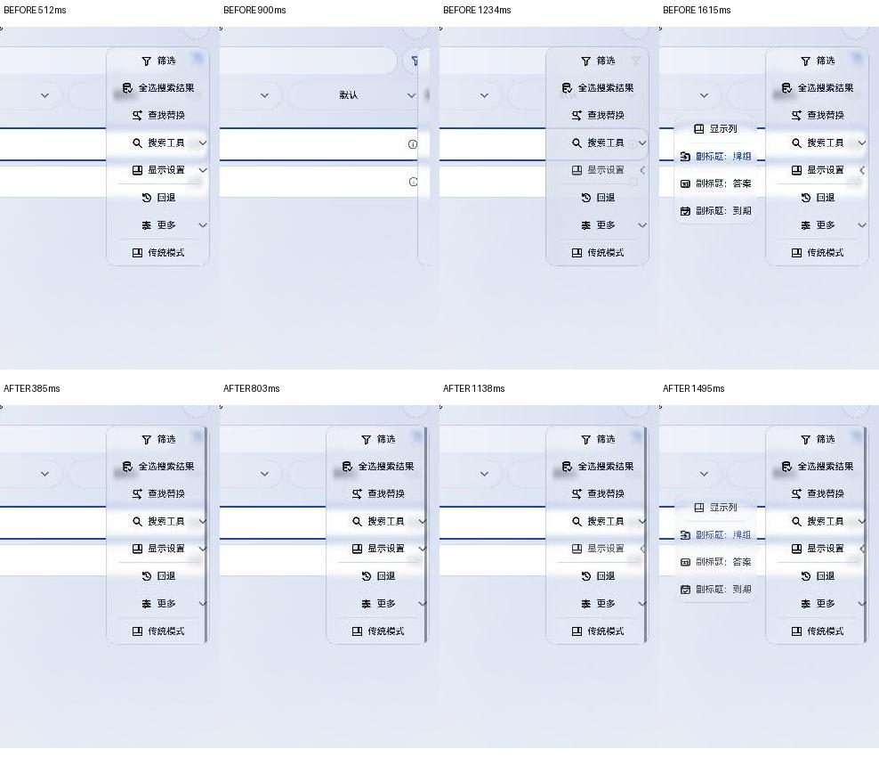

# 多级菜单使用稳定定位范围

状态：2026-10-31 已在连接的 MatePad 上操作验证，用户确认父菜单闪动已解决。

## 问题与实证

浏览页“更多”展开“显示设置”等子菜单时，父菜单短暂消失再出现。连续采样证实：它并非必须销毁组件，父面板会在一个过渡画面中被挤向屏幕右侧，只剩窄条，然后回到原位。

根因是整组宽度随子菜单显隐变化，外层右对齐位移与父列局部偏移分开参与布局，不能保证同帧提交。因此“生命周期日志没有重新打开”不能证明无闪动；仅稳定父列宽度、固定组件槽位或降低玻璃处理耗时也不充分。

## 不变量与责任

`CardActionMenu` 从首次打开即确定整组定位宽度及左右展开方向，主列与侧列使用固定槽位。子菜单显隐只影响自身，不改变父层定位范围。预留空区仍按外部点击关闭。平面菜单没有分支，不预留额外宽度。

可见面板各自限高滚动；主列滚动偏移参与侧列触发行锚点，侧列滚动偏移参与三级菜单锚点。并列侧菜单共享窗口高度预算，避免每个面板分别占满整屏而发生重叠。几何和回归归公共组件及 `ActionMenuLayout`，页面保留业务动作。

三级覆盖层从不包含自身的前两层容器采样，保持实际模糊与折射。玻璃日志记录稳定实例ID，只用于核对生命周期，不替代画面验收。

## 同类覆盖与验证

公共调用点：浏览更多、浏览批量操作、学习更多、卡片预览更多、首页牌组上下文菜单。已有选择器及牌组色调二级弹窗采用独立弹层，不存在同一总宽联动，不机械替换。

`shared-glass-integration` 断言展开前后主列及整组定位宽度不变；`study-menu` 覆盖镜像、窄宽视口、滚动锚点、并列面板预算与三级覆盖；`home-deck-menu` 保留调用范围。新增平台边界运行增量HAP。设备验收分别记录父菜单连续画面、子层返回、空区关闭及长列表滚动；不能用最终截图或“构建成功”代替全过程。
