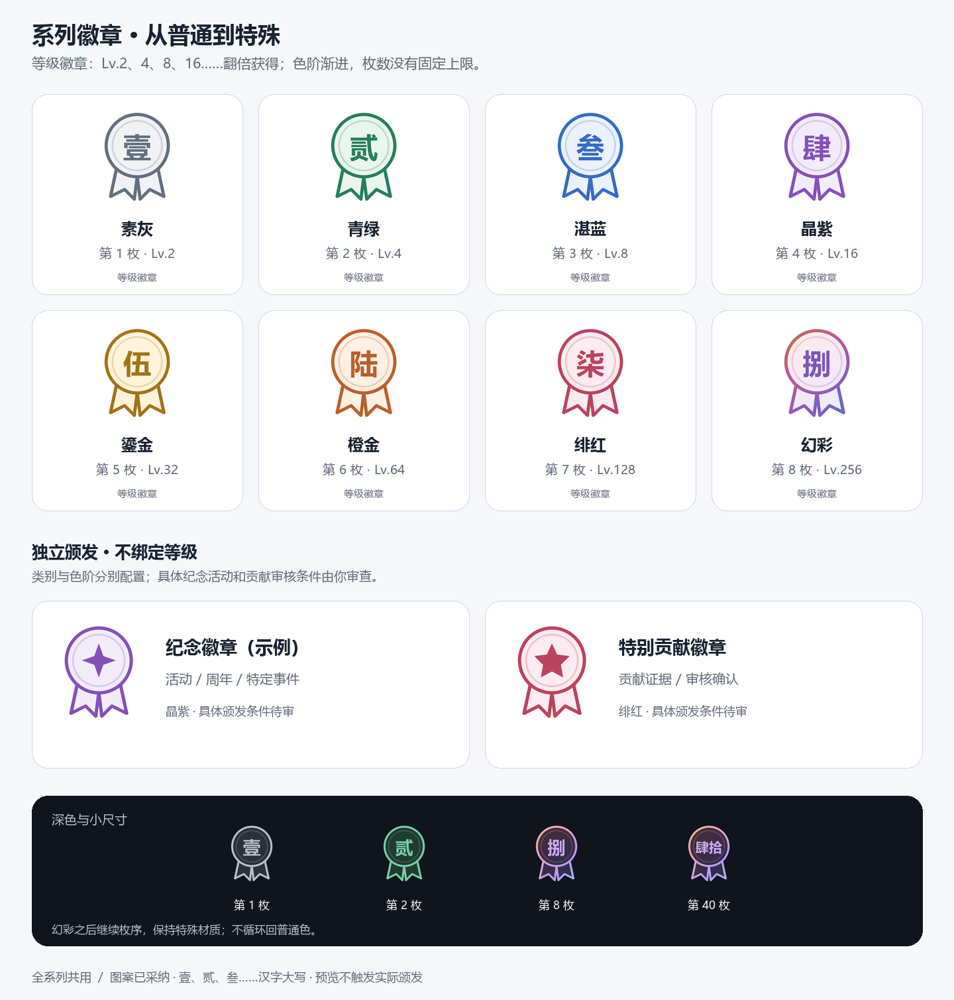

# 系列勋章：定义、外观与颁发

2026-10-15。徽章/勋章归记得全系列共用，可由闪卡、魔方、舒尔特、空间想象及后续应用按真实活动颁发。图案、名称与定义在本目录维护，产品只记录自身的活动适配和颁发来源。用户已确认徽章包含等级、纪念、特别贡献等类别；颜色应从普通到特殊。

## 类别、色阶与颁发条件

| 类别 | 获得依据 | 和等级的关系 |
| --- | --- | --- |
| 等级徽章 | 历史最高等级达到翻倍门槛 | 第 n 枚对应 Lv.`2^n` |
| 纪念徽章 | 周年、活动或特定事件的独立资格 | 不要求先达到某个等级 |
| 特别贡献徽章 | 经核验的贡献及审核决定 | 不由训练次数或等级自动换取 |

类别与色阶是两个独立维度。纪念/贡献不构成等级徽章的下一档，也不统一强制某种颜色；当前通用纪念/贡献模板采用紫/红配色。`MedalDefinition.category` 使用稳定字符串，后续可增加创始、活动等类别；图案 `motif` 当前支持数字、纪念星、贡献星，扩展新图案时在公共生成器增加实现。

2026-10-15 用户要求“应用好”，批准当前外观并接入空间想象；随后明确使用“壹、贰、叁……”汉字大写，并纠正首页定位：原单行“勋章＋等级”整体移至历史图标左边，不新加单独图标。纪念活动与特别贡献的具体事件、资格、审核标准仍未指定。当前[独立定义样例](../assets/medals/review-definitions.json)因此保持 `draft`，不能作为真实活动直接颁发。活动/周年各用独立稳定 ID；同一账户同一徽章默认只拥有一枚。

## 已确定的颁发规则

用户明确：段位无上限，每隔两倍获得一枚勋章。采用 **Lv.2、4、8、16、32、64……**，第一枚在 Lv.2 获得，第 n 枚门槛为 `2^n`。不设置业务枚数上限，预览数量不是勋章总数。

[DoublingLevelMilestones](../src/core/Levels.ts)实现 `LevelMilestoneSource`，按历史最高等级动态生成全部已达到的门槛；不需要预先穷举勋章表。ID 为 `jide.level-doubling.v1.<枚序>`，不含某个产品名称。跨级补齐中间勋章，重复贡献不重复颁发，当前等级回退不收回已获得勋章。

注入 `LevelRules.milestoneSource = new DoublingLevelMilestones()` 即可使用。静态 `milestones` 仍可为其他明确成就服务；同一 ID 不得重复。标尺、账户和规则版本仍由系列共享宿主统一，具体接入遵循[等级机制](等级机制上下文.md)。库的现有安全整数范围继续适用，没有另加业务等级上限。

## 已采纳外观

旧三枚图案不是完整方案，2/5/10 门槛已作废。当前统一圆章模板把等级枚序/纪念星/贡献星放在独立中心区域，等级类别名称为“成长徽章”。枚序使用 `medalNumeral` 格式化为汉字大写，等级文字和获得门槛仍使用 Lv.2、Lv.4 等原有格式。

当前配色为 **素灰 → 青绿 → 湛蓝 → 晶紫 → 鎏金 → 橙金 → 绯红 → 幻彩**，浅/深成对。等级徽章第 n 枚使用第 n 色阶；超过前八枚延续幻彩并继续枚序，不回绕普通色、不封顶等级或徽章数量。



图案由 [Medals.ts](../src/core/Medals.ts) 的 `medalSvg(artwork,dark)` 生成，`levelMedalSvg(ordinal,dark)` 保留原公共入口签名，供等级徽章调用。预览展示前八枚等级、纪念/贡献各一枚以及第 40 枚深色缩略例子。公共[资产目录](../assets/medals/catalog.json)的 `levelAwardRule` 仅约束等级徽章；`previewExamples`、`specialExamples` 和 `darkExamples` 都只是样例，不是有限的徽章总表。

从 `Levels.ets` 导入图案函数的调用不变；若旧实验直接引用内部 `src/core/Levels.ts` 的图案函数，应改为 `src/core/Medals.ts`。等级纯模型本身保持独立，现有产品调用方不依赖内部图案函数。

空间想象已完成规则迁移、等级徽章补发、图案展示和获得反馈，具体见产品接入与设备证据。纪念与贡献展示独立类别和已存在的颁发记录；没有虚构真实活动或贡献审核来发放样例。

Harmony `Image` 支持 SVG 资源，但不支持 SVG `<text>`，也不能以 Base64 SVG 加载。`levelMedalSvg(ordinal,dark,false)` 因此省略文字；[SharedMedalIcon](../src/harmony/MedalIcon.ets)用公共 `medalNumeral`/`medalInk` 配合原生 `Text` 居中显示汉字，其他平台可继续消费完整 SVG。图源使用实际打包资源，`supportSvg2(true)` 使用 API 21 起的渐变解析能力。[SharedMedalTile](../src/harmony/Medals.ets)组合图案、名称、条件、获得状态和时间，只接收展示数据。

## 已获得陈列、详情与佩戴

用户已要求计数下方用紧凑单行陈列，每个位置只显示一枚缩小的徽章，未获得的保留对应位置，特殊勋章单独放在下方；点击查看详情并选择佩戴。公共 [Medals.ets](../src/harmony/Medals.ets) 新增 `SharedMedalStrip` / `SharedMedalItem` 和 `SharedMedalDetails`，均从独立入口 `Levels.ets` 导出：

- 单行组件接收宿主已确认的 `items`、`wornId`、明暗/动效和 `onOpen(id)`。`earned: false` 淡显未获得位置；省略兼容已获得。每个位置只显示 40vp 图案，整行 68vp，不被外层滚动拉高；数量增长时横向滚动。缩略图使用同一 `SharedMedalIcon`，不另造图案或限制总枚数。名称、状态与条件通过可访问文本及详情提供。
- 用户进一步要求不附带背景、所有勋章加粗描边。陈列不显示卡片、选中框或底色，详情图案也没有卡片背景；公共 SVG 外轮廓由 2.5 加粗为 4.5，内圈为 2.5。外部透明区不新增填充，形状自身的色面保留。首页可将图案放在等级框旁，由宿主统一点击入口。
- 详情接收大图、名称、条件、原因、日期、来源和佩戴状态；操作按钮、导航与保存由宿主组合现有组件。状态与字段标签显式传入，其他应用可适配本地化。
- 纯规则 `resolveWornMedalId(accountId,owned,preference?)` 只允许佩戴当前账户真实拥有的任意类别，拒绝未获得、跨账户或重复拥有。`undefined` 兼容旧默认：取已有记录中最后一枚成长徽章；`''` 明确取消佩戴；稳定勋章 ID 表示用户选择。
- 宿主原子保存明确选择后，新颁发不覆盖它；切换佩戴不改变等级、资格、拥有记录或未读反馈。保存失败保持原展示并允许重试。跨应用共享选择仍须接通同一可信账户及存储，不因复用函数自动互通。

空间想象使用钱包 schema 1 的可选 `wornMedalId` 扩展，旧记录无需重置或补写；完整持久化与设备范围见产品接入。

## 颁发准备与跨应用适配

`Levels.ets` 同时导出独立的徽章类型与纯函数，`Medals.ts` 不依赖等级状态或积分。徽章定义保存 `id/version/category/name/condition/status/artwork`；颁发记录保存 `accountId/medalId/definitionVersion/category/productId/eventId/issuerId/eligibilityId/awardedAt/reason`。类别不是资格证明，`approved` 定义状态也不等于调用者拥有颁发权限。

可信共享宿主完成真实活动/审核资格验证后，在账户事务内读取已有记录、调用 `prepareMedalAward(definition,request,existing)` 并原子保存结果。该函数拒绝草案、坏元数据和同事件的矛盾重试；同账户同 ID 已有时返回首次记录，不因另一应用或新定义版本重发或覆盖原始来源。它不修改传入记录，不读写存储，不验证账号身份，也不自行批准贡献。

宿主必须对 `(accountId,medalId)` 建唯一约束或提供等价的跨应用串行事务；不能并行读取同一旧快照后各自保存。贡献审核的 `eligibilityId` 应指向可信审核决定，纪念徽章应指向真实活动资格。特定活动未达到条件时宿主不调用颁发函数。回退等级不收回独立勋章。

- 同一系列账户消费相同门槛、稳定勋章 ID 和定义版本。不同应用贡献同一等级进度，不在各产品重新定义同名勋章的外观或阈值。
- 真实完成事实保留 `productId + activityId` 并幂等提交；颁发记录的 `eventId` 对应这一来源事件。现有等级 `achievementIds` 只是拥有列表，独立徽章的颁发记录不能塞入等级快照后冒充完整账本。
- 产品接入文档负责说明有效活动、贡献换算和业务入口。未联通的应用显示本机或未同步状态，不声称已和其他应用共享奖励。
- 已有纯定义/外观/颁发准备和去重规则；空间想象提供本机持久化台账。系列账号、审核后台、云端同步和跨设备颁发事务尚未接通，不能把本机台账当作系列共享账户服务。

## 文件与验证

- [等级规则](../src/core/Levels.ts)：`DoublingLevelMilestones`。
- [独立徽章规则和图案生成器](../src/core/Medals.ts)：定义、颁发准备、`medalSvg`、`levelMedalSvg`。
- [SVG 样例](../assets/medals/drafts/level-2.svg)、[第八枚样例](../assets/medals/drafts/level-256.svg)：沿用原 `drafts` 路径以保持链接；外观状态以资产目录为准，AGPL-3.0-or-later。
- [预览生成入口](../tools/render-medal-review.mjs)：调用真实规则与图案生成器，再由 Pillow 读取生成的 SVG 路径、颜色和渐变渲染，不另画第二套图案；可用 `MEDIA_PYTHON` 指定含 Pillow 的 Python。该预览只支持本模板使用的 SVG 子集，不表示平台渲染验收。

在 `D:/Projects/记得系列基础` 运行：

```powershell
node --test tests/levels.test.mjs tests/medals.test.mjs
node tools/render-medal-review.mjs
node tools/check.mjs
node tools/build-levels.mjs
```

翻倍回归覆盖 Lv.1 不颁发、Lv.2/4/8/16/32 门槛、40 次翻倍、跨级、导入、重复提交及降级保留；独立颁发覆盖无等级输入、跨应用去重、来源保留、审核草案拒绝及冲突重试，另覆盖汉字大写枚序和 Harmony 图源省略不支持的文字标签。

2026-10-15 本次验证：`node --test tests/levels.test.mjs tests/medals.test.mjs` 19/19，`node tools/check.mjs` 通过。空间想象完整回归 39 项及原生 24 项检查通过，真实 HAP 编译和覆盖安装通过；模拟器保留原 10 局并完成到 15 局/Lv.4，补发“壹”并新获得“贰”，关闭反馈后重启不重发。源码/资源哈希及实际截图见产品验收。深色、读屏、大字体及手机真机未验收；真实系列同步和纪念/贡献资格服务未实现。
